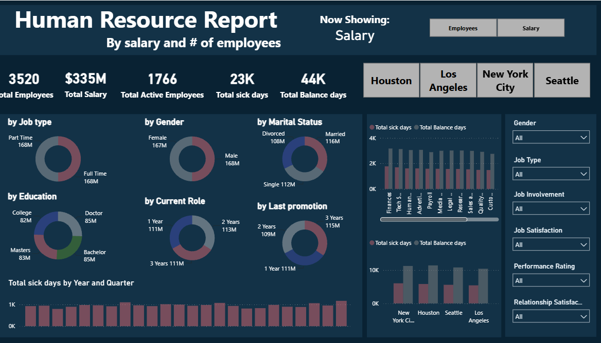

# HR Analytics Dashboard

An interactive Power BI dashboard that analyzes employee data. It shows headcount, salary and leave days, and lets users break them down by department, education, gender and more.

## Dashboard Preview

## Features
- KPI cards: Total Employees, Total Active Employees, Total Salary, Total Sick Days, Total Balance Days
- Donut charts by Gender, Education, Marital Status, Job Type, Last Promotion and Years in Current Role
- Column charts for deeper comparison
- Slicers to filter by Business Unit, Department, Job Satisfaction, Job Involvement, Performance Rating, Relationship Satisfaction and Hire Date

## Data
Sample HR dataset provided during training.
File: `data/HR_Data.xlsx`

## Tools Used
- Power BI
- Excel

## How to Open
1. Download `HR_Analytics_Dashboard.pbix`
2. Open it in Power BI Desktop

## Author
Mownika V
GitHub: Mownika-70
LinkedIn: linkedin.com/in/mownika-v-50988a275
